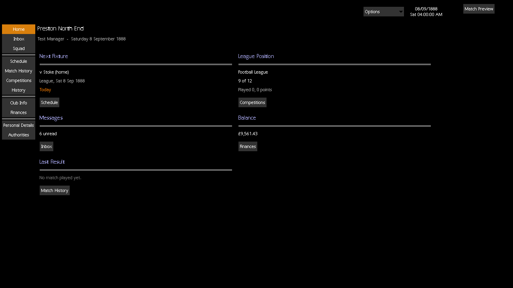
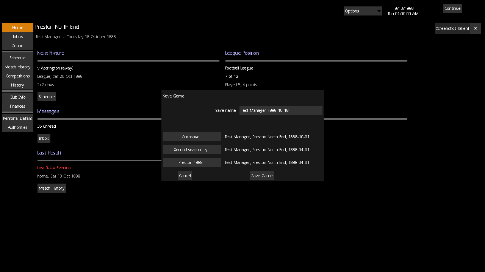
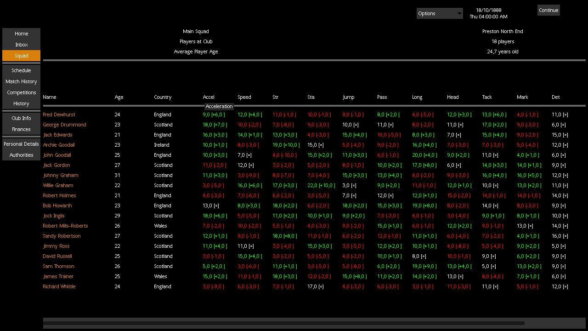
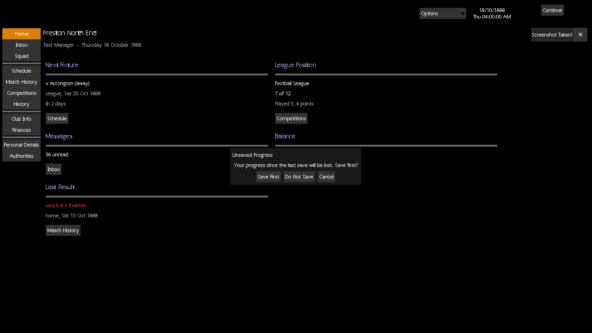
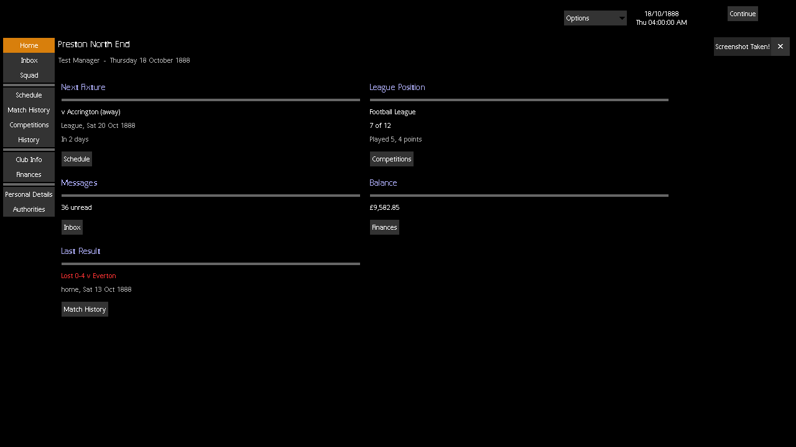
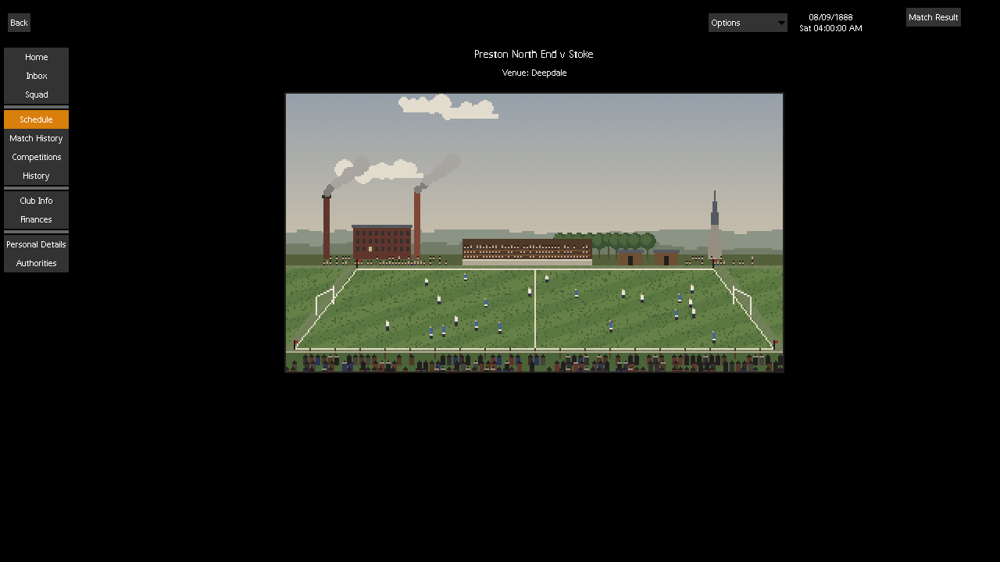
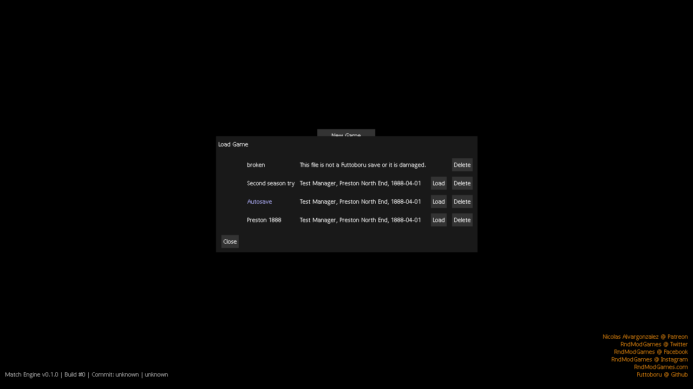
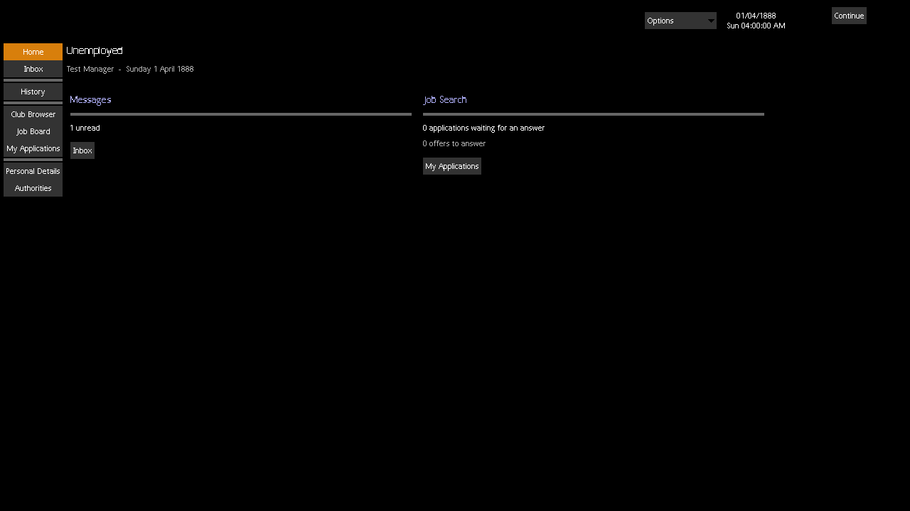
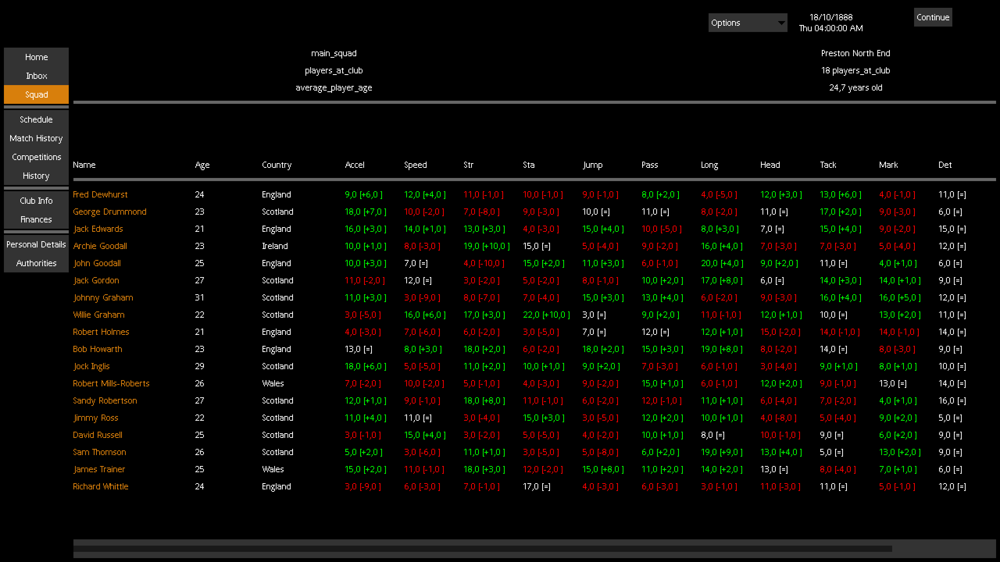

# Interface guide (U-05)

How Futtoboru screens look and behave, for anyone adding or changing a screen. The images are our own captures
from the screenshot tour (section 8). The audit behind this guide is `docs/design/UI_AUDIT.md`.

## 1. Principles
- **Black background, one bitmap font family** (the `tixel` skin, `skin/tixel.json`). No FreeType (P1-4).
- **Tokens only.** Colours, pads, sizes, font roles and styles come from `ui/theme.json` through `UiTheme`
  (`UiTheme.color("state.positive")`, `space("sm")`, `size("col.club")`). `UiThemeTest` fails on new literals.
- **Words come from the language files** (`mods/language/BaseBundle_*.properties`, all 4 bundles; `LanguageBundleKeysTest`).
- **Dates and numbers in the game language, never the machine's** (U-12): `GameFormat.mediumDate / numericDate /
  longDate / weekdayDate / time / decimal / integer / format` (`com.rndmodgames.localization`). Patterns are bundle keys
  (`date_*_pattern`, `time_pattern`, `clock_pattern`), month and day names come from the language's locale
  (en-US, en-GB, es-ES, es-419). Money stays `Money.format`. `GameFormatGuardTest` fails on a new
  `DateTimeFormatter.ofPattern` / `String.format` / `DecimalFormat` in the UI packages and inbox letters.
- **1888 tone.** Secretary, committee, ground, gate, umpire, letter. No modern jargon (no scouts' reports,
  no transfer windows, no cards).
- **1280×720 is the smallest window (D18).** Everything must work there at 1×; 2× must give the same layout.

## 2. Layout


The in-game screen (`MainGameScreen`) has three parts:

| Part | What is in it |
|---|---|
| Top bar (`MainGameMenuTable`) | Back (left, only when there is somewhere to go back to) · Options box · date and time · the one action button (Continue / Match Preview / Match Result / "Inbox: Make the Draw") with the busy bar under it |
| Left menu (`MainMenuManager`, `MenuEntries`) | One toggle button per entry, grouped by separators; the entry of the screen shown is highlighted (orange), drill-downs keep their entry highlighted |
| Content | One `*ScreenTable` at a time. It starts at the **top**, and when it has no scroll pane of its own `MainMenuManager.fitContent` puts it in a vertical scroll pane. Content that is too wide scrolls sideways (`UiScale.newWideOverflowScrollPane`) |

- Gaps: `spacing.xxs` 2, `xs` 5, `sm` 10, `md` 15, `lg` 20, `xl` 50. Pad tables with `xs`, separate sections with `md`/`lg`.
- Column widths: `sizes.col.*` (`col.number` 100, `col.label` 150, `col.wide` 200, `col.club` 250).
- A screen title is a heading label at the top, then `addSeparator()` across the full width. In a table with
  columns, give the separator a `colspan` of all columns, or it widens the first column and pushes the rest right.
- Menu, Settings and the new-game screens are centred pages: their root goes through `UiScale.addOverflowScroll`
  (never `setFillParent`).

## 3. Components

| Component | How | Example |
|---|---|---|
| Button | `VisTextButton`, default skin style; disabled = grey text (`setDisabled`) | Save Game, Cancel in  |
| Toggle button | `UiTheme.style("button.toggle")`; checked = orange (`accent`) | the left menu |
| Primary button | `UiTheme.style("button.primary")`: the one main action of a panel | Send the Invitation (Schedule, arrange a friendly) |
| Labels by role | font roles `display` 1.5, `title` 1.3, `heading` 1.2, `subheading` 1.1, `body` 1.0, `small` 0.9 (`UiTheme.fontScale`); section headings use `text.heading` (lavender) | dashboard cards above |
| Link | VisUI `LinkLabel` (skin orange, hand cursor) for every link: in-game ones (player, club, score) and web ones (`new LinkLabel(text, url)` opens the browser). One link colour; no other label is coloured as a link | squad names, Authorities (Wikipedia), Club Info source |
| Select box | `VisSelectBox`; the Options box keeps showing "Options" after a pick | top bar |
| Data table | header row, full-width separator, rows; numbers right-aligned in fixed `col.*` widths; abbreviated headers get a tooltip |  |
| Dialog | through `UiDialogs` only (section 5) |  |
| Toast | `MainGameScreen.toastShort(text)`, top right under the top bar, 5 s |  |
| Busy bar | under the action button while a day is processed (`busybar.w`/`busybar.h`) | top bar |
| Ground picture | `GroundArt` (Nearest, whole-number scale; a placeholder panel when there is no art) |  |

## 4. Colour semantics
Colours say something about **the game**, never "this is a number".

| Token | Meaning |
|---|---|
| `text.primary` / `text.secondary` / `text.muted` | normal text / supporting line / not decided yet or empty ("Winner of R1M1", "No match played yet.") |
| `text.heading` | section headings (dashboard cards, Competitions sections) |
| `accent` | the selected menu entry, "Today" |
| `state.positive` / `state.negative` | good / bad **for the player's club** (profit, a win, a counter-offer accepted) |
| `state.warning`, `state.critical` | needs attention / blocks play |
| `state.winner`, `match.winner` | round titles of a cup, the winner of a tie |
| `modifier.up/down`, `trend.up/down/flat` | attribute change since the last snapshot (squad `[+2]`) |
| `rating.*` | attribute quality bands, gold to red |
| `category.*` | inbox categories (league cyan, cup gold, authority orange, match green, job magenta, system white) |
| `status.filled/vacant`, `application.*` | job screens |
| `selection`, `indicator.unread` | the selected row, unread marker (links take the `LinkLabel` skin colour, no token) |

Keep contrast: muted text (`grey-50`) goes on black or on the dark `button` background, never on `button-over`.

## 5. Windows and dialogs
- **One modal at a time.** Open every dialog with `UiDialogs.show / info / confirm`; a dialog that opens another
  replaces itself. `SaveGameDialog` and `LoadGameDialog` call `UiDialogs.track` before `super.show`.
- **Esc is the dialog's Cancel / Close / OK, never a destructive choice** (U-12). `UiDialogs.confirm` takes the value
  Esc answers with (the Cancel button's: unsaved progress → Cancel, never Do Not Save; Delete / Overwrite → Cancel);
  `info` and `show` close; a dialog class sets its own with `UiDialogs.closeOnEscape(this, this::hide)`. The key is
  caught at the dialog (also while typing in its text field) and stops there, so the top-bar Back does not run.
- Dialogs are for a question that blocks the player's action (save over a name, delete a save, unsaved progress,
  a failed load). News, results and replies are **inbox messages**, not dialogs. A draw that blocks time is a
  message plus the top-bar button, not a dialog.
- Toasts only confirm something the player just did (screenshot taken). Never put information only in a toast.



## 6. Tooltips
One tooltip layer (`ui/UiTooltips`, VisUI `Tooltip`, shared delay and style). Every abbreviated column header has
one: league tables (Pld, W, D, L, GF, GA, Pts: `UiTooltips.LEAGUE_COLUMNS`) and the squad attributes
(`SQUAD_ATTRIBUTE_COLUMNS`). Use `UiTooltips.header(labelKey, tipKey)`; the tip text is a bundle key too.

## 7. Navigation map and keys
```
Menu ─ New Game → Season (+ Create Manager) → Countries → Overview → in game
     ─ Load Game (dialog) → in game        ─ Settings → back to Menu
     ─ Match Engine Debug → 2D viewer (only with -Dfuttoboru.dev=true, docs/BUILD.md) ─ Quit
     Settings: Language switches at once (saved) and Settings is built again in it
In game: top bar Options = Save | Load | Settings | Quit to menu | Quit to desktop
         (Load and both Quits ask Save First / Do Not Save / Cancel when there is unsaved progress)
  manager:    Home, Inbox, Squad | Schedule, Match History, Competitions, History | Club Info, Finances |
              Personal Details, Authorities
  job seeker: Home, Inbox | History | Club Browser, Job Board, My Applications | Personal Details, Authorities
  drill-downs: Competitions → League / Cup detail → Cup bracket; Squad → Player; Club Browser → Club detail;
               My Applications → Job offers ⇄ Negotiation; Inbox / top bar → League or Cup draw;
               Schedule ← Match Preview → Match Result (top bar)
```
- **Esc**: closes the open dialog (its Cancel, section 5); otherwise Back in game (the top-bar Back button,
  `NavigationHistory`); in Settings, back to where you came from.
- **F12**: screenshot of the window to `Documents/RndModGames/Futtuboru/screenshots`, with a toast (in game only).
- To add a menu entry: one `MenuEntry` in `MenuEntries.ALL`, and its drill-downs in `DRILL_DOWNS`.



## 8. Screenshot procedure
`tools/ui/screenshots.sh` (Git Bash; `tools\ui\screenshots.bat` in cmd) runs the dev-only `ScreenshotTour`: a real
window, seed 1888, a new game through `NewGameFixture`, every screen, drill-down and dialog, first at 1280×720 1×,
then at 2560×1440 2× (the second pass needs a monitor that can hold that window). PNGs go to
`target/screenshots/1x` and `2x` (see `docs/BUILD.md`). Look at every image after a UI change. Only our own
captures go in `docs/design/img/`; keep that set small (about one per screen at 1×, a few at 2×). In a running game
F12 also takes a screenshot.

2× gives the same layout as 1× at twice the pixels: 

More captures: [menu](img/menu-1x.png) · [settings](img/settings-1x.png) ([2×](img/settings-2x.png)) ·
[new game overview](img/new-game-overview-1x.png) · [league draw](img/league-draw-1x.png) ·
[inbox](img/inbox-1x.png) · [competitions](img/competitions-1x.png) · [cup bracket](img/cup-bracket-1x.png) ·
[finances](img/finances-1x.png) · [match result](img/match-result-1x.png) · [home at 2×](img/home-match-day-2x.png)

## 9. Checklist for a new screen
1. A `*ScreenTable` shown by `MainMenuManager.setActiveMainScreen` (a `case` there, or the entry shows an empty
   panel), plus a `MenuEntry` or a drill-down mapping.
2. Every word through `LanguageModLoader.getValue(key)`, the key in all 4 bundles; dates and numbers through `GameFormat`.
3. Colours, pads, sizes and styles from `UiTheme` tokens; no `setDebug`, no `setFontScale` literals.
4. Header separators span all columns; long lists inside a scroll pane, or leave it to `fitContent`.
5. Dialogs through `UiDialogs`; abbreviations with a tooltip.
6. A stop in `ScreenshotTour`; run it and look at the 1× and 2× images at 1280×720.
